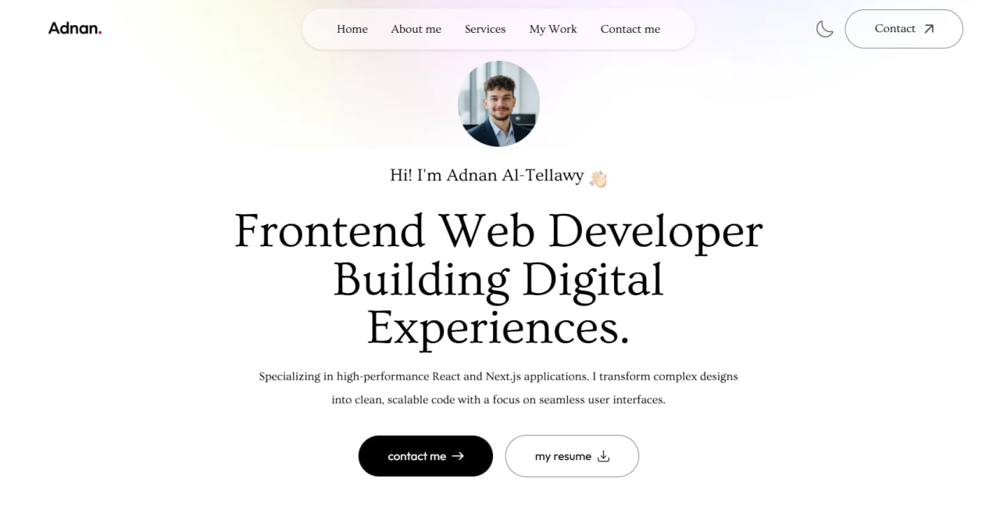
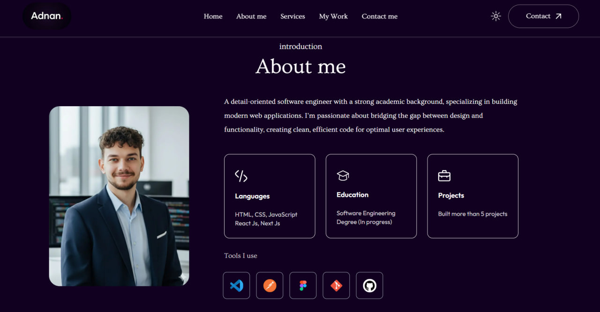

# Personal Portfolio Website

A responsive personal portfolio showcasing my projects, services, and contact details, with light and dark modes and smooth animations.

Live demo: https://adnan-altellawy.netlify.app

## Screenshots

## Features

- Fully responsive layout for mobile, tablet, and desktop
- Light and dark theme switch
- Smooth image and text animations using the Motion library
- Projects and services sections
- Contact form
- Responsive navigation menu

## Tech Stack

- [Next.js](https://nextjs.org/)
- [Tailwind CSS](https://tailwindcss.com/)
- [Motion](https://motion.dev/) for animations
- Deployed on [Netlify](https://www.netlify.com/)

## Getting Started

git clone https://github.com/Adnan-AlTellawy/portfolio.git
cd portfolio
npm install
npm run dev
Then open http://localhost:3000 in your browser.

## Author

Adnan Jahed Al-Tellawy — Front-End Developer
[GitHub](https://github.com/Adnan-AlTellawy) · [LinkedIn](https://www.linkedin.com/in/adnan-altellawy-497500448) · [Portfolio](https://adnan-altellawy.netlify.app) · adnanaltellawy@gmail.com